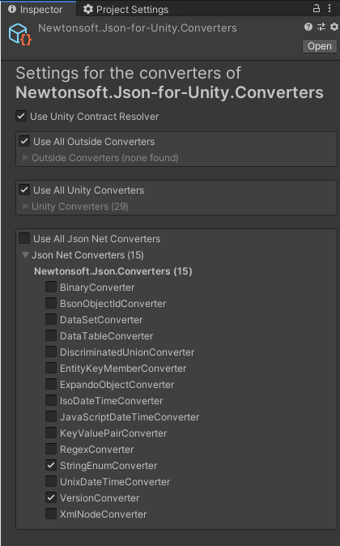

# Unity Converters for Newtonsoft.Json

[](https://unity.com/)
[](LICENSE.md)

This is a fork of https://github.com/applejag/Newtonsoft.Json-for-Unity.Converters for personal use

This package contains converters to and from common Unity types for Newtonsoft.Json (Json.NET). Types such as **Vector2, Vector3, Vector4, Matrix4x4, Quaternion, Color, Bounds, Rect, Resolution, and even ScriptableObject**, *and many more*.

(See the [full compatibility table of all +50 supported Unity types][doc-compatability-table])

---

## Dependencies

### Newtonsoft.Json packages

- **Unity's official Newtonsoft.Json package** *(recommended)*:  
  [`com.unity.nuget.newtonsoft-json`](https://docs.unity3d.com/Packages/com.unity.nuget.newtonsoft-json@3.2/manual/index.html) (available directly via Unity Registry)

---

## Installation

Install directly via Git URL in Unity Package Manager:

1. In Unity, open the Package Manager (**Window > Package Manager**).
2. Click the **"+"** icon in the top-left corner and select **"Add package from git URL..."**.
3. Paste the repository URL:
   ```text
   https://github.com/plantcraft94/Newtonsoft.Json-for-Unity.Converters.git
   ```
4. Click **Add**. Unity will automatically download and install the package.

---

## What does it solve?

Many Unity types cause self-referencing loops when serialized by default. For example, serializing a `new Vector3(0, 1, 0)` will recursively evaluate `normalized`, leading to a `JsonSerializationException`:

```json
{
  "x": 0,
  "y": 1,
  "z": 0,
  "normalized": {
    "x": 0,
    "y": 1,
    "z": 0,
    "normalized": {
      ...
    }
  }
}
```

Other types like `UnityEngine.RandomState` hide internal state variables from public serialization.

The converters in this package resolve these issues cleanly and efficiently.

### Example without this package

```csharp
using UnityEngine;
using Newtonsoft.Json;

public class Sample : MonoBehaviour {
    void Start() {
        var json = JsonConvert.SerializeObject(transform.position);
        Debug.Log("Position as JSON: " + json);
    }
}
```

Output:
```log
JsonSerializationException: Self referencing loop detected for property 'normalized' with type 'UnityEngine.Vector3'. Path 'normalized'.
```

### Example with this package

With this package added, serializing Unity types works out-of-the-box:

```json
{"x":201.0,"y":219.5,"z":0.0}
```

---

## Configuring converters

### Automatic Configuration

All converters are automatically registered to default `JsonSerializerSettings` upon Unity initialization.

### Custom settings via ScriptableObject

You can customize enabled/disabled converters through a settings asset:

1. Click **"Edit"** in the Unity menu bar and select **"Json.NET converters settings..."**.
2. Enable or disable individual converters as needed.
3. The configuration is saved to `Assets/Resources/Newtonsoft.Json-for-Unity.Converters.asset`.



---

## Contributing

Feel free to open issues or submit pull requests on GitHub:
- [Open an Issue](https://github.com/plantcraft94/Newtonsoft.Json-for-Unity.Converters/issues)
- [Submit a Pull Request](https://github.com/plantcraft94/Newtonsoft.Json-for-Unity.Converters/pulls)

---

## Changelog

See the [CHANGELOG.md](CHANGELOG.md) file for release history and migration notes.

---

## License

This project is licensed under the [MIT License](LICENSE.md).

- Copyright (c) 2026 plantcraft94
- Original work Copyright (c) 2019 Kalle Fagerberg (jilleJr / applejag)
- Portions Copyright (c) 2007 ParentElement

[doc-compatability-table]: Documentation~/Compatability-table.md
